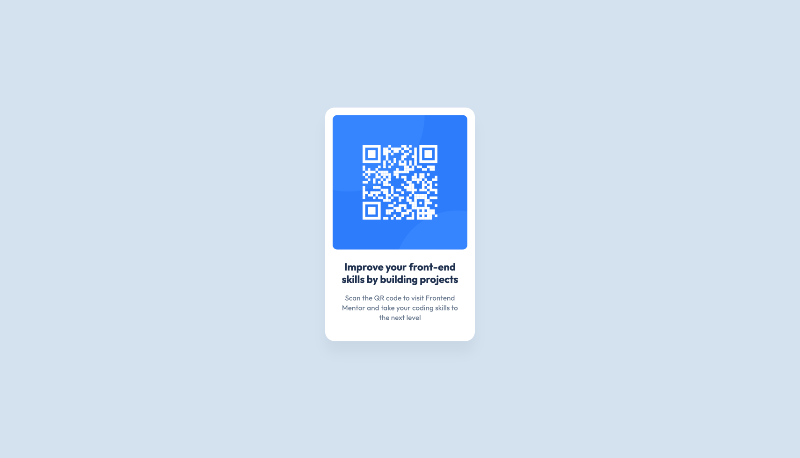

# Frontend Mentor - QR code component solution

This is a solution to the [QR code component challenge on Frontend Mentor](https://www.frontendmentor.io/challenges/qr-code-component-iux_sIO_H). Frontend Mentor challenges help you improve your coding skills by building realistic projects.

## Table of contents

- [Overview](#overview)
  - [Screenshot](#screenshot)
  - [Links](#links)
- [My process](#my-process)
  - [Built with](#built-with)
  - [What I learned](#what-i-learned)
  - [Continued development](#continued-development)
  - [Useful resources](#useful-resources)
  - [AI Collaboration](#ai-collaboration)
- [Author](#author)
- [Acknowledgments](#acknowledgments)

**Note: Delete this note and update the table of contents based on what sections you keep.**

## Overview

QR Code component solution using tailwind css with some costume values based on the style-guide.md

### Screenshot

### Links

- Live Site URL: [Add live QR Code Site Solution](https://nefta2.github.io/frontend-mentor-qr-component/)

## My process

### Built with

- Semantic HTML5 markup
- CSS custom properties
- Flexbox
- Tailwind CSS

### What I learned

You need to run this command to use the most recent tailwind css classes:
npx @tailwindcss/cli -i ./src/input.css -o ./src/output.css --watch

### Continued development

-Responsive Design
-Mobile first development

### Useful resources

- [Tailwind CSS Documentation](https://tailwindcss.com/)

## Author

- [One Portfolio By Diego Burgos (basically my portfolio ;)](https://oneportfoliobydiegoburgos.vercel.app/)
